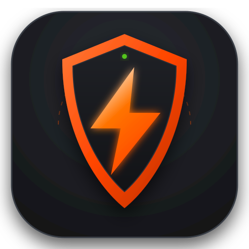

# ZeroState — By GrGeorge

**A fast, lightweight, debloated, privacy-first web browser for Linux and Windows.**

Built natively in **C++17** and **Qt6 WebEngine**, ZeroState strips away corporate telemetry, tracking, advertising bloat, and unwanted background services. It delivers built-in uBlock-grade shielding, zero-ad YouTube playback, local AI assistance, native SearXNG metasearch, multi-language UI, and direct Chrome Web Store extension support.

---

<p align="center">
  
</p>

<p align="center">
  <a href="https://github.com/GrGeorge06/braveLite/releases"></a>
  <a href="https://github.com/GrGeorge06/braveLite/releases"></a>
  
  <a href="LICENSE.txt"></a>
</p>

> 🎉 **Officially Out of Beta!**
> Welcome to **ZeroState Complete Release v1.72**. All beta experimental flags have graduated to stable release status, featuring robust multi-platform stability, fluid DPI scaling, seamless tab management, and complete Windows & Linux desktop integration.

---

## Table of Contents

- [Quick Installation Guide](#quick-installation-guide)
  - [Windows Installation](#-windows-installation)
    - [Bypassing SmartScreen](#bypassing-smartscreen)
  - [Linux Installation](#-linux-installation)
- [Building from Source](#building-from-source)
  - [Linux (Fedora, Ubuntu, Arch, openSUSE)](#linux-build)
  - [Windows (MSVC & Ninja)](#windows-build)
- [Linux Desktop Integration (App Menu & Icons)](#linux-desktop-integration)
- [Key Features](#key-features)
- [Default Keyboard Shortcuts](#default-keyboard-shortcuts)
- [File & Storage Locations](#file--storage-locations)
- [Uninstallation Guide](#uninstallation-guide)
  - [Uninstalling on Linux](#-uninstalling-on-linux)
  - [Uninstalling on Windows](#-uninstalling-on-windows)
- [License](#license)

---

## Quick Installation Guide

### 🪟 Windows Installation

#### Option 1: Automated Installer (Recommended)
1. Go to the [**ZeroState Releases**](https://github.com/GrGeorge06/braveLite/releases) page.
2. Download the latest **`ZeroState-Setup-x64.exe`**.
3. Run the installer. It will:
   - Install ZeroState to your local application folder.
   - Automatically bundle all necessary Qt6 and WebEngine dependencies.
   - Create a desktop shortcut and a Start Menu entry.
4. Launch **ZeroState** directly from your desktop or Start Menu!

#### Bypassing SmartScreen

> [!NOTE]
> **Windows Defender SmartScreen Notice:**  
> Because ZeroState is a community-developed, open-source browser and does not carry an expensive corporate EV code-signing certificate (\$400+/year), Windows Defender SmartScreen may display a blue dialog:
>
> *"Windows protected your PC — Microsoft Defender SmartScreen prevented an unrecognized app from starting."*
>
> **This is completely normal and expected for unsigned open-source binaries.**
>
> To proceed:
> 1. Click **More info** (under the notification text).
> 2. Click the **Run anyway** button that appears at the bottom.
>
> ZeroState is 100% open-source under the MIT license; its entire source code is auditable in this repository.

---

### 🐧 Linux Installation

You can build and install ZeroState in a couple of minutes on any modern Linux distribution.

#### 1. Install System Dependencies

Select your distribution below and run the command in your terminal:

* **Fedora / RHEL / CentOS Stream:**
  ```bash
  sudo dnf install -y gcc-c++ cmake ninja-build \
      qt6-qtbase-devel qt6-qtwebengine-devel \
      qt6-qtsvg-devel ImageMagick
  ```

* **Ubuntu / Debian / Linux Mint / Pop!_OS:**
  ```bash
  sudo apt update
  sudo apt install -y build-essential cmake ninja-build \
      qt6-base-dev qt6-webengine-dev qt6-webengine-dev-tools \
      libqt6svg6-dev imagemagick
  ```

* **Arch Linux / Manjaro / EndeavourOS:**
  ```bash
  sudo pacman -S --needed base-devel cmake ninja \
      qt6-base qt6-webengine qt6-svg imagemagick
  ```

* **openSUSE (Tumbleweed / Leap):**
  ```bash
  sudo zypper install -y gcc-c++ cmake ninja \
      qt6-base-devel qt6-webengine-devel \
      qt6-svg-devel ImageMagick
  ```

* **Alpine Linux:**
  ```bash
  sudo apk add g++ cmake ninja \
      qt6-qtbase-dev qt6-qtwebengine-dev \
      qt6-qtsvg-dev imagemagick
  ```

#### 2. Clone and Compile

```bash
# Clone the repository
git clone https://github.com/GrGeorge06/braveLite.git ZeroState
cd ZeroState

# Configure and compile with Ninja
cmake -B build -G Ninja -DCMAKE_BUILD_TYPE=Release
ninja -C build
```

#### 3. Test Run

Launch the compiled browser immediately:
```bash
./build/ZeroState
```

---

## Linux Desktop Integration

To install ZeroState permanently so it appears in your system application launcher (GNOME, KDE Plasma, XFCE, Cinnamon, etc.) with its official high-resolution icon:

Run this automated setup block inside your project directory:

```bash
# 1. Create executable symlink in ~/.local/bin
mkdir -p ~/.local/bin
ln -sf "$(pwd)/build/ZeroState" ~/.local/bin/zerostate

# 2. Install application icons across all standard resolutions
for size in 16 22 24 32 48 64 128 256 512; do
    dir="$HOME/.local/share/icons/hicolor/${size}x${size}/apps"
    mkdir -p "$dir"
    if command -v rsvg-convert >/dev/null 2>&1; then
        rsvg-convert -w "$size" -h "$size" assets/zerostate.svg -o "$dir/zerostate.png"
    elif command -v magick >/dev/null 2>&1; then
        magick -background none -resize "${size}x${size}" assets/zerostate.svg "$dir/zerostate.png"
    elif command -v convert >/dev/null 2>&1; then
        convert -background none -resize "${size}x${size}" assets/zerostate.svg "$dir/zerostate.png"
    fi
    cp "$dir/zerostate.png" "$dir/ZeroState.png" 2>/dev/null || true
done

mkdir -p ~/.local/share/icons/hicolor/scalable/apps
cp assets/zerostate.svg ~/.local/share/icons/hicolor/scalable/apps/zerostate.svg
cp assets/zerostate.svg ~/.local/share/icons/hicolor/scalable/apps/ZeroState.svg
gtk-update-icon-cache -f -t ~/.local/share/icons/hicolor 2>/dev/null || true

# 3. Create Desktop Launcher entry
mkdir -p ~/.local/share/applications
cat << EOF > ~/.local/share/applications/zerostate.desktop
[Desktop Entry]
Name=ZeroState
GenericName=Web Browser
Comment=Fast, debloated, privacy-respecting browser
Exec=$HOME/.local/bin/zerostate %U
Terminal=false
Type=Application
Icon=zerostate
Categories=Network;WebBrowser;
MimeType=text/html;text/xml;application/xhtml+xml;x-scheme-handler/http;x-scheme-handler/https;
StartupNotify=true
StartupWMClass=ZeroState
EOF

update-desktop-database ~/.local/share/applications 2>/dev/null || true
```

ZeroState is now registered as a native desktop application! You can launch it by searching for **ZeroState** in your applications menu.

---

## Building from Source

### Linux Build
```bash
git clone https://github.com/GrGeorge06/braveLite.git ZeroState
cd ZeroState
cmake -B build -G Ninja -DCMAKE_BUILD_TYPE=Release
ninja -C build
```

Whenever you pull code updates, simply re-run:
```bash
ninja -C build
```
Because `~/.local/bin/zerostate` links directly to your build binary, your installed desktop app updates instantly.

---

### Windows Build

#### Prerequisites:
- **Visual Studio 2022** (with *Desktop development with C++*)
- **CMake** (3.16+) and **Ninja**
- **Qt 6.7+** (with `qtwebengine`, `qtwebchannel`, `qtpositioning`)
- *(Optional)* **Inno Setup 6** (to produce `ZeroState-Setup-x64.exe`)

#### Compilation Steps:
1. Open the **x64 Native Tools Command Prompt for VS 2022**.
2. Clone the repository and navigate into it:
   ```cmd
   git clone https://github.com/GrGeorge06/braveLite.git ZeroState
   cd ZeroState
   ```
3. Configure CMake with your Qt directory:
   ```cmd
   cmake -B build -G Ninja -DCMAKE_BUILD_TYPE=Release -DCMAKE_PREFIX_PATH="C:\Qt\6.7.3\msvc2019_64"
   ```
4. Build the executable:
   ```cmd
   ninja -C build
   ```
5. Deploy Qt runtime libraries:
   ```cmd
   mkdir dist
   copy build\ZeroState.exe dist\ZeroState.exe
   C:\Qt\6.7.3\msvc2019_64\bin\windeployqt.exe --release dist\ZeroState.exe
   ```
6. *(Optional)* Build the Inno Setup installer:
   ```cmd
   "C:\Program Files (x86)\Inno Setup 6\ISCC.exe" installer.iss
   ```

---

## Key Features

- 🛡️ **Zero-Ad Experience & uBlock-Grade Shields:** Built-in network request interception and DOM shielding that eliminates advertisements, trackers, pop-unders, and preroll/midroll video ads on YouTube out of the box with zero third-party extensions required.
- 🔍 **Native Metasearch & Multi-Engine Switching:** Default local SearXNG metasearch integration (`http://localhost:8080/`) alongside 1-click toggling between **SearXNG**, **Google**, **Microsoft Bing**, **DuckDuckGo**, **Yahoo**, and **Yandex**.
- 🧩 **Chrome Web Store Native Installer:** Browse the [Chrome Web Store](https://chromewebstore.google.com/) and click "Add to Chrome" to install extensions directly into ZeroState, with full support for unpacked WebExtensions and custom userscripts (`.user.js`).
- 🤖 **Offline Local AI Assistant & Page Summarization:** Built-in side chat panel powered by local Ollama LLMs (`smollm2`, `qwen2.5`, `llama3.2`). Instant link AI summaries with `Ctrl` + hover, 100% private with no remote cloud telemetry.
- 🌐 **Comprehensive Multi-Language Support:** Full browser localization across 6 languages: **English**, **Greek (Ελληνικά)**, **Spanish (Español)**, **French (Français)**, **German (Deutsch)**, and **Chinese (中文)**. Dynamically synchronizes settings, start page clock, omnibox suggestions, and HTTP `Accept-Language` headers.
- 📑 **Modern Tab Bar & Window Mechanics:** Chrome-style dynamic tab scaling (from 185px to 28px) prevents tabs from ever disappearing. Supports detachable tabs, drag-and-drop merging between windows, split-view tabs, and complete session recovery ("Continue where you left off").
- 🪟 **Fluid Border Resizing:** Smooth click-and-drag window resizing from all 4 borders and corners (`WM_NCHITTEST` on Windows, native system resize on Linux).
- 🔑 **Self-Hosted Password Manager & Autofill:** Secure local credentials vault with automatic login form prompt-to-fill and submission detection.
- 🎵 **Spotify Web Playback & Widevine DRM:** Out-of-the-box Widevine CDM support for DRM-protected streaming on Spotify and Netflix (`libwidevinecdm.so` on Linux, `widevinecdm.dll` on Windows).
- 🎨 **Real-Time Instant Theme Engine:** Five built-in themes (ZeroState Dark, Midnight OLED, Cyberpunk Neon, Nordic Frost, Catppuccin Mocha) with instant switching without restarting.
- 🔎 **Ubiquitous Floating Find in Page (`Ctrl+F`):** Floating top-right search pill with real-time match counter (`1/3`), navigation arrows, and DOM auto-scrolling.
- 🔒 **Isolated Incognito Sessions:** Memory-only private browsing (`Ctrl+Shift+N`) leaving zero traces of cookies, cache, or history on disk.

---

## Default Keyboard Shortcuts

| Shortcut | Action |
| :--- | :--- |
| `Ctrl + T` | Open a new tab |
| `Ctrl + W` | Close the current tab |
| `Ctrl + N` | Open a new window |
| `Ctrl + Shift + N` | Open an Incognito window |
| `Ctrl + F` | Find in page |
| `Ctrl + H` | Open History |
| `Ctrl + J` | Open Downloads |
| `Ctrl + D` | Add bookmark |
| `Ctrl + Shift + O` | Open Bookmarks manager |
| `Ctrl + +` / `Ctrl + =` | Zoom in |
| `Ctrl + -` | Zoom out |
| `Ctrl + 0` | Reset zoom (100%) |
| `Ctrl + Shift + Del` | Quick clear cookies, cache, and history |
| `Alt + Left` | Back |
| `Alt + Right` | Forward |
| `Ctrl + R` / `F5` | Reload page |
| `F11` | Toggle Fullscreen |

---

## File & Storage Locations

ZeroState stores configuration and cache locally in standard OS profile directories:

### Linux
* **Settings & Bookmarks:** `~/.config/ZeroState/data.json`
* **Persistent Web Storage & Cookies:** `~/.config/ZeroState/Storage/`
* **Crash Logs:** `~/.config/ZeroState/CrashLogs/`
* **Desktop Launcher:** `~/.local/share/applications/zerostate.desktop`

### Windows
* **Settings & Storage:** `%LOCALAPPDATA%\ZeroState\` and `%APPDATA%\ZeroState\`
* **Installed Location:** `%LOCALAPPDATA%\Programs\ZeroState\` or `C:\Program Files\ZeroState\`

---

## Uninstallation Guide

If you ever wish to remove ZeroState from your computer, follow the simple instructions below for your operating system:

### 🐧 Uninstalling on Linux

To remove the desktop launcher, application icons, and binary link, run:

```bash
# 1. Remove the executable symlink
rm -f ~/.local/bin/zerostate

# 2. Remove the desktop launcher and update application menu database
rm -f ~/.local/share/applications/zerostate.desktop
update-desktop-database ~/.local/share/applications 2>/dev/null || true

# 3. Remove application icons and refresh icon cache
rm -f ~/.local/share/icons/hicolor/*/apps/zerostate.*
gtk-update-icon-cache -f -t ~/.local/share/icons/hicolor 2>/dev/null || true
```

#### Completely Erase User Data & Profiles (Optional)
If you also want to delete all saved bookmarks, history, logins, and cookies:
```bash
rm -rf ~/.config/ZeroState
```

Finally, you can safely delete the cloned repository directory:
```bash
cd .. && rm -rf ZeroState
```

---

### 🪟 Uninstalling on Windows

#### Option 1: If Installed via the Setup Installer
1. Open Windows **Settings** (`Win + I`) and navigate to **Apps** > **Installed apps** (or open **Control Panel** > **Programs and Features**).
2. Locate **ZeroState** in the list.
3. Click the three dots (or right-click) and select **Uninstall**.
4. Follow the setup wizard to remove the application, Start Menu shortcuts, and desktop icon.

#### Option 2: If Built Manually from Source
1. Simply delete the cloned project directory or `dist` folder.

#### Completely Erase User Data & Profiles (Optional)
To delete all saved browsing data, cookies, and settings:
1. Press `Win + R`, type `%LOCALAPPDATA%`, and press **Enter**. Delete the `ZeroState` folder.
2. Press `Win + R`, type `%APPDATA%`, and press **Enter**. Delete any `ZeroState` folder if present.

---

## License

This project is licensed under the [MIT License](LICENSE.txt).
Developed by **GrGeorge**.
